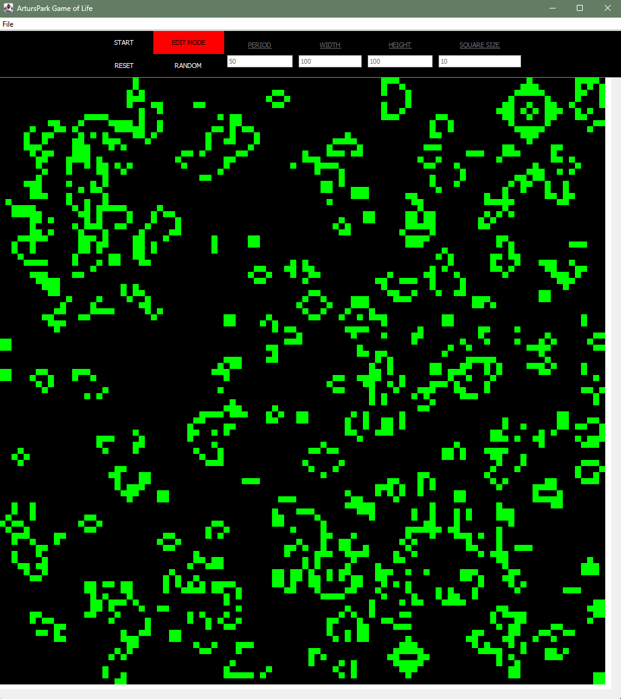

# AP_GameOfLife

A Java Swing app for Conway's Game of Life.

<p align="center">
  
</p>

## Features

- **Reusable grids:** Ping-pong buffering avoids allocating a new map each generation.
- **Parallel processing:** Uses CPU threads for generation updates and randomization on larger grids.
- **Padded borders:** A border of dead cells avoids boundary checks when counting neighbors.
- **Selective rendering:** Paints the visible grid region and skips unchanged dead cells.
- **Interactive controls:** Edit cells, adjust speed and grid/cell size, randomize, and save/load maps.

Requires JDK 11+ and Bash. Use Git Bash on Windows.

Run from the project folder:

```bash
bash ./run.sh
```

Build only:

```bash
bash ./run.sh --build-only
```

Reference: [Conway's Game of Life — Wikipedia](https://en.wikipedia.org/wiki/Conway%27s_Game_of_Life).
